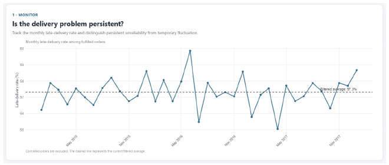
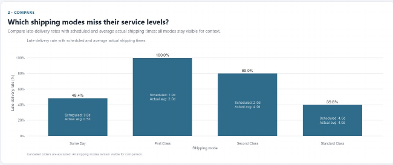
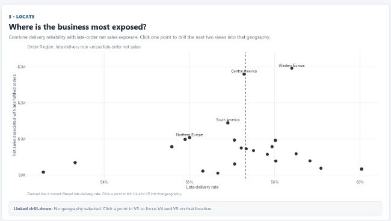
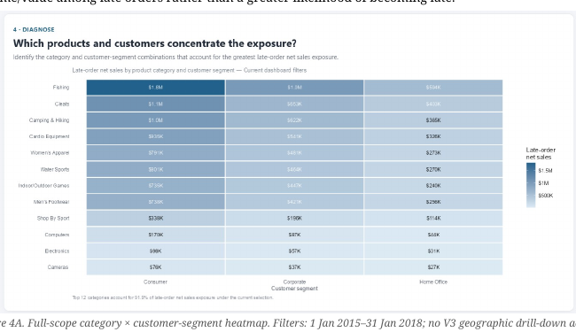
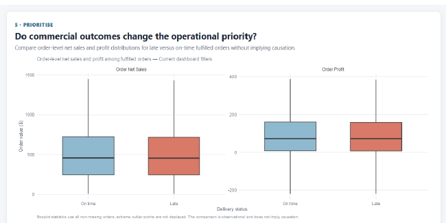

# E-Commerce Fulfilment Performance Analytics

An independent portfolio case study adapted from an academic R Shiny project. It demonstrates how an e-commerce operations manager can monitor fulfilment reliability, compare shipping services, locate commercial exposure, diagnose product and customer concentrations, and prioritise investigation. It was not commissioned by a client.

## Business question and audience

For a regional head of e-commerce operations: how persistent is late fulfilment, which shipping services miss their scheduled times, and where should investigation focus when operational risk is considered alongside sales associated with late orders?

## Data and methods

The supplied dataset has 180,519 order-item rows representing 65,752 unique orders, dated January 2015–January 2018. The app counts delivery KPIs at unique Order Id level, excludes cancelled orders from timeliness rates, and aggregates item sales to order level. The CSV contains customer-related fields and is intentionally absent from this repository. Source and access details are in [DATA_SOURCE.md](DATA_SOURCE.md); the exact expected filename and schema are in [requirements.md](requirements.md).

Built with **R**, **Shiny**, and **ggplot2**. No additional R packages are required by `app.R`.

## Verified KPIs

| Measure | Full-scope value |
| --- | ---: |
| Unique orders | 65,752 |
| Fulfilled orders | 62,897 |
| Late fulfilled orders | 36,048 |
| Late-delivery rate | 57.31% |
| Net sales associated with late fulfilled orders | approximately 18.08 million, dataset currency unverified |

First Class has a 100% late-delivery rate; Second Class is approximately 79.99%. The associated sales are commercial exposure, **not proven financial loss**. See [business insights](report/business_insights.md) and the [QA summary](evidence/qa_summary.md).

## Dashboard

Five linked views follow **Monitor → Compare → Locate → Diagnose → Prioritise**:

1. Monthly late-delivery rate and its overall reference.
2. Shipping-mode late rates with scheduled and actual shipping times.
3. Geographic late rate versus late-order sales exposure, with click-through selection.
4. Product-category and customer-segment exposure within the selected context.
5. Order-level sales and profit distributions for late and on-time fulfilled orders.

Controls include date range, shipping mode, customer segment, geographic level, drill-down, clear selection, and reset. Screenshots below are cropped from the completed assignment report; they show existing dashboard outputs and contain no rebuilt charts.

## Run locally

Place an **authorised** copy of `data.csv` next to `app.R`. Install R and the `shiny` and `ggplot2` packages. Start R in this folder with a UTF-8 locale that can read the supplied Latin-1 CSV, then run `shiny::runApp('.')`. The CSV is not bundled here. The app uses `read.csv('data.csv', fileEncoding='latin1')` relative to its working directory; verify that the console reports 65,752 orders and the KPIs above before relying on the result. On the audited Windows machine, setting `Sys.setlocale('LC_ALL', 'English_United States.utf8')` before launch allowed the complete file to load. Other systems may require an equivalent locale.

## Scope and limits

This is a descriptive portfolio demonstration, not a production-certified deployment. Main KPIs were independently reconciled. Three data-quality assertions failed; profit contributions are missing for some orders, some shipping durations are missing, and CSV ingestion is locale-sensitive. Browser interactions have not been fully verified. Profit values are useful for descriptive comparisons but should not support causal or definitive accounting claims. Dataset redistribution rights and currency denomination have not been independently established. The original dashboard code is preserved unchanged.
